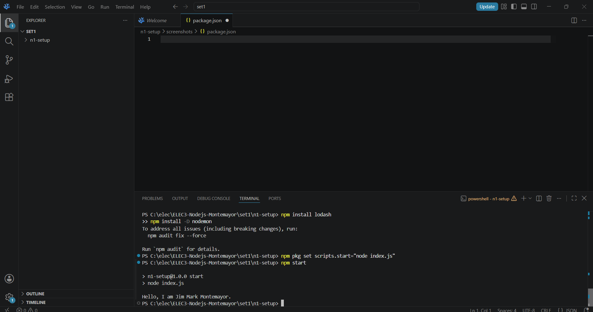
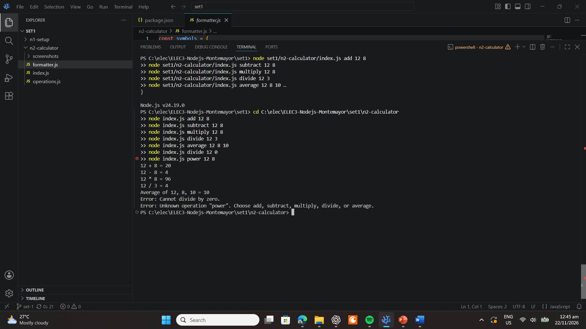

# ELEC 3 - Node.js

**Name:** Jim Mark Montemayor  
**Section:** IV-BSIT C  
**Course:** ELEC 3 - Node.js

## Set 1

### N1: Project Setup and Package Management

Initialized an npm project, installed regular and development dependencies, and added a start script.

Run from the repository root:

```powershell
cd set1/n1-setup
npm install
npm start
```

Screenshot of the program output:



### N2: Modular Calculator

[Activity folder](set1/n2-calculator) — A calculator that uses separate modules for arithmetic and output formatting.

Run from the repository root:

```powershell
node set1/n2-calculator/index.js add 12 8
```



### N3: File Manager

[Activity folder](set1/n3-file-manager) contains a command line file manager that uses Node's built-in fs and path modules.

Run from the repository root:

```powershell
cd set1/n3-file-manager
node index.js create notes.txt "First line"
node index.js read notes.txt
node index.js update notes.txt "Second line"
node index.js list
```

To remove a file you no longer need, run `node index.js delete notes.txt`.
